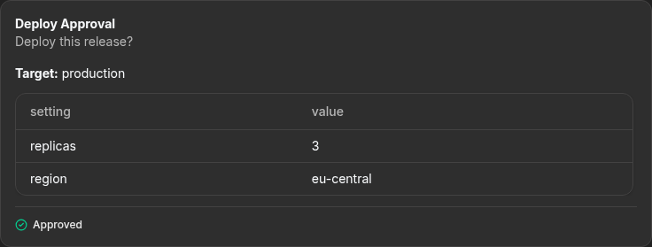
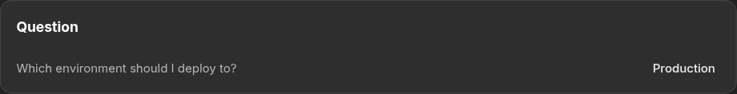
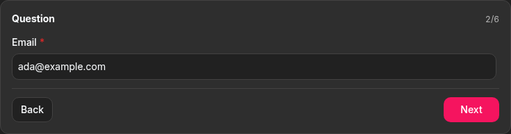
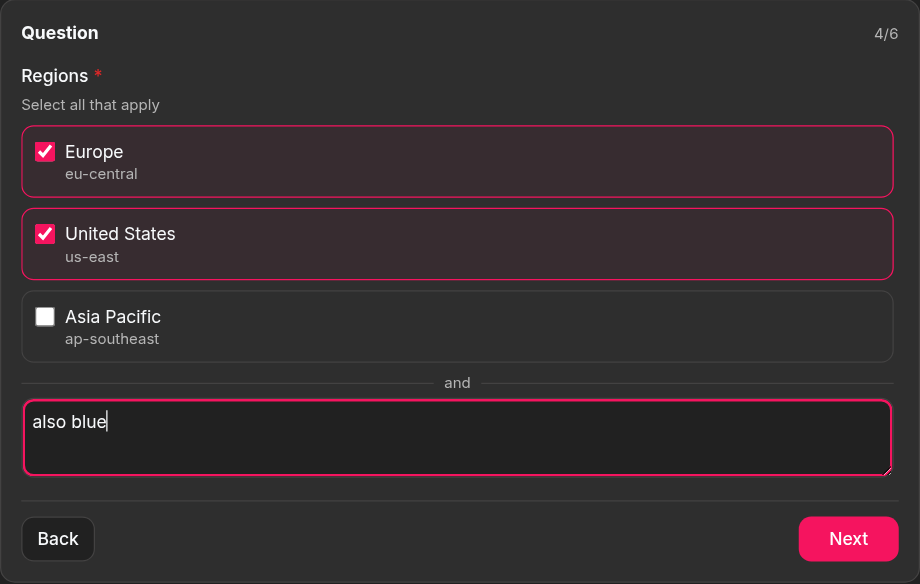
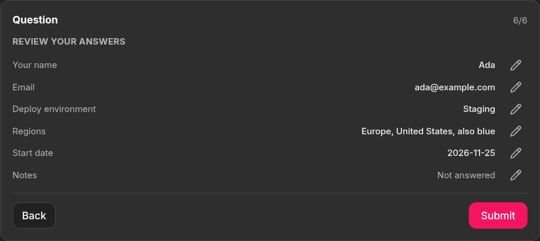
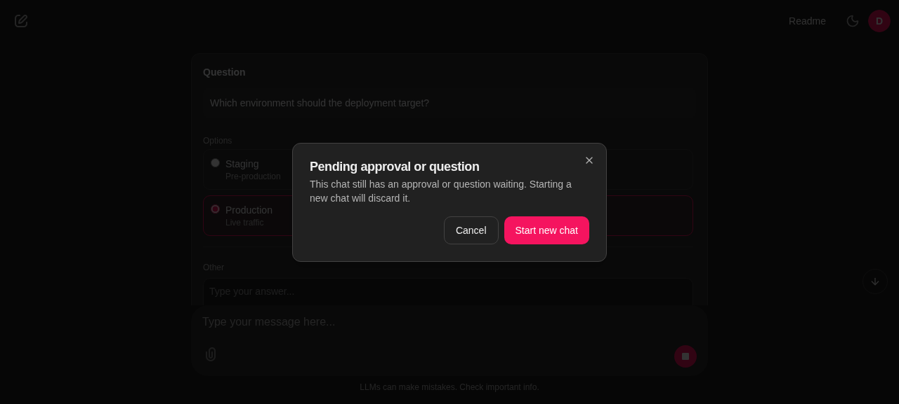
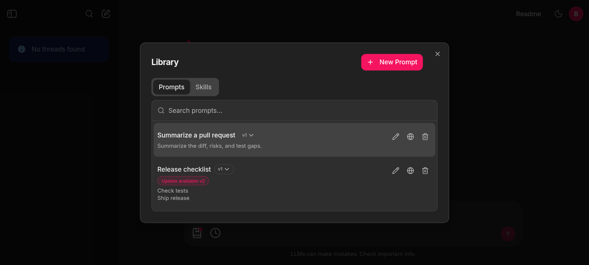
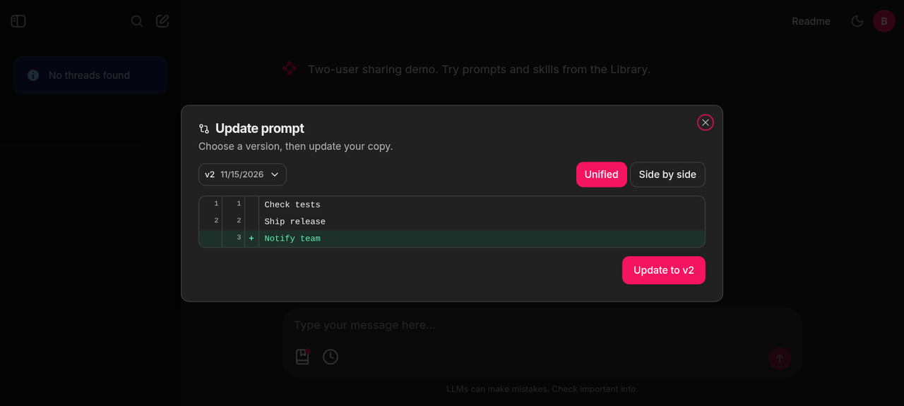
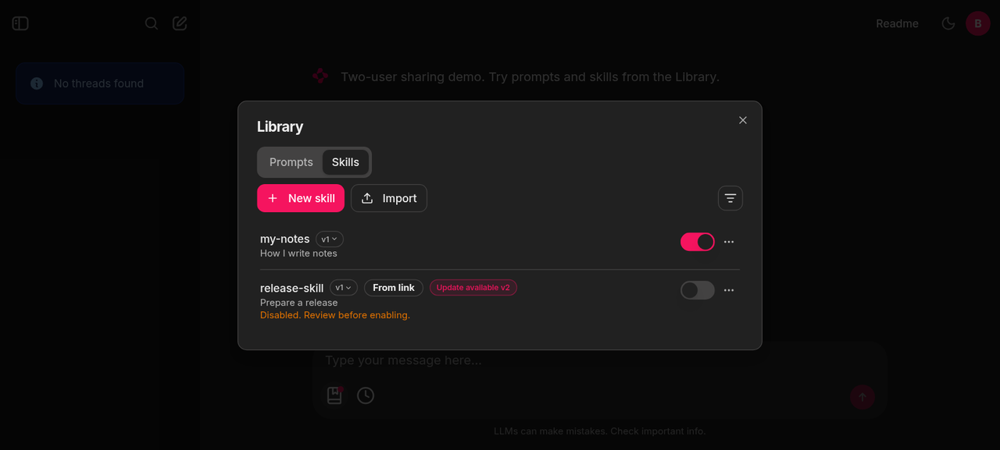
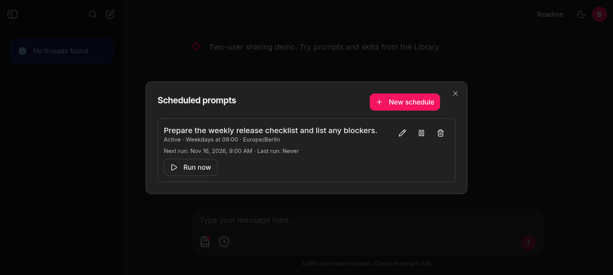

<h1 align="center">Chainlit NG</h1>

<p align="center">
  <b>Build production-ready conversational AI applications in Python.</b><br />
  Tool-call approvals, agent questions, a versioned prompt and skill library, observability, and a modern React 19 frontend — in minutes, not weeks.
</p>

<p align="center">
  <a href="https://pypi.org/project/chainlit-ng/"></a>
  <a href="https://www.npmjs.com/package/@chainlit-ng/react-client"></a>
  <a href="LICENSE"></a>
</p>

> **Fork notice**
>
> Chainlit NG is an independent fork of the original [Chainlit](https://github.com/Chainlit/chainlit) project. The upstream project is no longer actively maintained. This line continues development with security fixes, a React 19 frontend, and the interaction features below.
>
> The Python import is still `import chainlit as cl`. Only the distribution and CLI names changed.

## Install

```sh
pip install chainlit-ng
```

Requires Python 3.10 or newer. The CLI is now `chainlit-ng`; the `chainlit` command remains as an alias, so existing scripts keep working.

```sh
chainlit-ng hello
```

If the hello app opens in your browser, you are all set.

## Quickstart

Create `demo.py`:

```python
import chainlit as cl


@cl.step(type="tool")
async def tool():
    # Fake tool
    await cl.sleep(2)
    return "Response from the tool!"


@cl.on_message  # called every time a user sends a message
async def main(message: cl.Message):
    tool_res = await tool()
    await cl.Message(content=tool_res).send()
```

Run it with auto-reload:

```sh
chainlit-ng run demo.py -w
```

## What's in 3.0

- **Tool-call approvals.** Pause a tool with `@cl.step(requires_approval=True)` or the explicit `cl.Approval` API. The server keeps the real arguments; the card shows a redacted preview. Users can approve, reject, edit generated form fields, or request changes with a comment. Resolved cards show a colored decision status. See [docs/approvals.md](docs/approvals.md).
- **Agent questions.** `cl.ask` supports a single question or a multi-field wizard with text, email, date, number, URL, phone, single-select, and checkbox multi-select fields. Fields can be prefilled or optional; free text can accompany checked options; the wizard has 1/N progress, Back and Next, and a review step. Answers carry per-field provenance and are marked as untrusted user input. See [docs/questions.md](docs/questions.md).
- **Thread sharing and grants.** Opt-in read-only sharing with named users, scoped by the data layer. See [docs/thread-sharing.md](docs/thread-sharing.md).
- **Safer MCP.** Servers are declared by name in server-side config, user-provided servers require an explicit URL allowlist, and per-user OAuth is supported for streamable HTTP. See [docs/mcp-oauth.md](docs/mcp-oauth.md).
- **OpenTelemetry traces.** Opt-in OTLP/HTTP export from the step tree, with a fixed redaction allowlist and bounded span attributes. See [docs/telemetry.md](docs/telemetry.md).
- **Library, prompts, and skills.** One Library dialog with Prompts and Skills tabs. Save, search, insert, edit, share, and version prompts; create, import, review, enable, share, and update skills. See [Prompt and skill Library](#prompt-and-skill-library).
- **Scheduled prompts.** Carried forward from 2.12: recurring prompt runs with model selection, optional chat profiles, and optional after-hooks. See [Scheduled prompts](#scheduled-prompts).
- **UI improvements.** Optional message timestamps, compact chain-of-thought display, side-view opening by element id, and a configurable upload directory outside `APP_ROOT`.

## Structured questions

`cl.ask` accepts one question or a typed multi-field form. Checkbox questions
use `multiple=True` and can combine checked options with an optional Other
answer.

```python
answer = await cl.ask(
    questions=[
        cl.Question("Email", id="email", type="email"),
        cl.Question(
            "Regions",
            id="regions",
            type="choice",
            multiple=True,
            options=[
                cl.QuestionOption("eu", "Europe"),
                cl.QuestionOption("us", "United States"),
                cl.QuestionOption("apac", "Asia Pacific"),
            ],
            default=["eu", "us"],
            allow_free_text=True,
        ),
        cl.Question("Start date", id="start", type="date"),
        cl.Question("Notes", id="notes", type="text", required=False),
    ]
)

answer.answers["email"].text
answer.answers["regions"].option_ids
answer.answers["regions"].labels
```

The card shows one field at a time with `1/6` progress, Back and Next, and a
review step before Submit. Typed fields validate in the browser and again on the
server; optional fields are omitted from the answer. Checkbox answers return
`option_ids` plus `labels`, and their Other text is additive. See
[docs/questions.md](docs/questions.md) for the full contract.

## Prompt and skill Library

With both features enabled, the composer Library is the entry point. It uses one
icon and one dialog with two tabs instead of separate composer buttons.

```toml
[features]
prompt_gallery = true
skills = true
```

Prompt gallery entries and per-user skill rows live in the data layer. Sharing links require
authentication; a no-auth app hides the share controls and rejects share and
link-add requests.

### Prompts

- Save composer text as a prompt, create one from the Library, search, insert,
  edit, and delete.
- Share a prompt by link. Every content change appends an immutable version.
- Open a shared link to add a pinned copy. The copy keeps the source version it
  was added from and never updates silently.
- When the source moves ahead, the Library shows a grouped notice, an update
  chip, and a diff against the source version. Update, downgrade to an older
  version, or detach explicitly. A downgrade refreshes the notice without
  re-alerting for a version that was already acknowledged.
- Versions written before the share link are private. Public routes expose only
  the share baseline and later versions.

### Skills

- Author a skill in Markdown, import one, export it, or add a shared copy.
- The Library filters skills by All, Active, Needs review, and Updates.
- Imports and shared copies start disabled. Use the enable toggle to open the
  review dialog, inspect the instructions, and enable the reviewed version.
- Local self-authored edits keep the skill enabled. Edits to an imported or
  pinned skill disable it until the changed body is reviewed again.
- Skills use the same version and pinned-copy contract as prompts. Applying a
  source version stores the copy disabled, so it must pass review before use.

See [docs/skills.md](docs/skills.md) and
[docs/prompt-versioning.md](docs/prompt-versioning.md) for the full model and
API contract.

## Scheduled prompts

Scheduled prompts reuse the app's message path: the scheduler prepares the saved
model and chat profile, then calls `on_message` on the selected recurrence.

```toml
[features]
prompt_scheduling = true
prompt_gallery = true # optional: reuse saved prompts in the picker
```

Scheduling requires authentication and a data layer with scheduled-task support.
Register `set_scheduled_task_models` to show a model dropdown; with one model the
dropdown is hidden and that model is used automatically. When the app exposes
more than one chat profile, the form also shows a profile selector. Optional
after-hooks are registered with `after_scheduled_task`.
Recurrence presets cover daily, weekdays, weekly, monthly, and a custom
every-N-hours schedule. The browser timezone is used automatically.

See [docs/scheduled-prompts.md](docs/scheduled-prompts.md) for the callback
contract, model application, after-hooks, and recurrence details.

## Screenshots

### Approvals

<table>
  <tr>
    <td width="50%">
      
      <p align="center"><sub>Review a tool call and decide.</sub></p>
    </td>
    <td width="50%">
      
      <p align="center"><sub>Resolved cards keep a clear status line.</sub></p>
    </td>
  </tr>
</table>

### Structured questions

<table>
  <tr>
    <td width="50%">
      
      <p align="center"><sub>Single question with options and free text.</sub></p>
    </td>
    <td width="50%">
      
      <p align="center"><sub>The answer stays visible after submission.</sub></p>
    </td>
  </tr>
  <tr>
    <td width="50%">
      
      <p align="center"><sub>Typed fields with progress and Back/Next.</sub></p>
    </td>
    <td width="50%">
      
      <p align="center"><sub>Checkbox answers can add an Other answer.</sub></p>
    </td>
  </tr>
  <tr>
    <td colspan="2" align="center">
      
      <p align="center"><sub>Review every answer before submitting.</sub></p>
    </td>
  </tr>
</table>

<p align="center">
  
  <br />
  <sub>Starting a new chat warns before discarding a pending approval or question.</sub>
</p>

### Library and scheduled prompts

<table>
  <tr>
    <td width="50%">
      
      <p align="center"><sub>One Library for saved prompts and skills.</sub></p>
    </td>
    <td width="50%">
      
      <p align="center"><sub>Review a source version before updating a pinned copy.</sub></p>
    </td>
  </tr>
  <tr>
    <td width="50%">
      
      <p align="center"><sub>Imported skills stay disabled until reviewed.</sub></p>
    </td>
    <td width="50%">
      
      <p align="center"><sub>Recurring prompts with timezone and next run.</sub></p>
    </td>
  </tr>
</table>

## Security fixes

Security fixes in this line include:

- MCP CVE-2026-45018 (client-supplied stdio command execution) and CVE-2026-45019 (SSRF via user-provided MCP URLs and headers). See the [MCP advisory](docs/security-advisory-2026-mcp.md).
- Azure AD hybrid OAuth state and `id_token` verification with a per-login nonce.
- A structured 422 response for lone UTF-16 surrogates instead of a 500.
- Element ownership checks and upload validation.
- Markdown and media rendering hardening.
- Thread-grant ACLs, including owner-identity stripping for grantees.
- OpenTelemetry redaction and export bounds.

This is not a claim that every upstream bug is fixed. See the [changelog](CHANGELOG.md) for the full list.

## Migrating

Upgrading from upstream Chainlit 2.x or a 2.12 fork build? The [3.0 migration guide](docs/migration-3.0.md) covers the Python and npm renames, the Recoil to Zustand change, and breaking configuration updates.

The short version:

```sh
pip uninstall chainlit
pip install chainlit-ng==3.0.0
```

```sh
npm uninstall @chainlit/react-client
npm install @chainlit-ng/react-client@3.0.0
```

## Contributing

Contributions are welcome, whether it is a bug report, a documentation fix, or a feature. Start with [CONTRIBUTING.md](CONTRIBUTING.md), then run the backend and frontend checks described there before opening a pull request.

## License

Chainlit NG is open source under the [Apache License 2.0](LICENSE).

## Fork attribution

Chainlit NG is an independent fork of [Chainlit](https://github.com/Chainlit/chainlit). The original project is no longer actively maintained upstream. This repository continues that work under the Apache-2.0 license; the original authors and contributors retain credit for the code and documentation they wrote.
