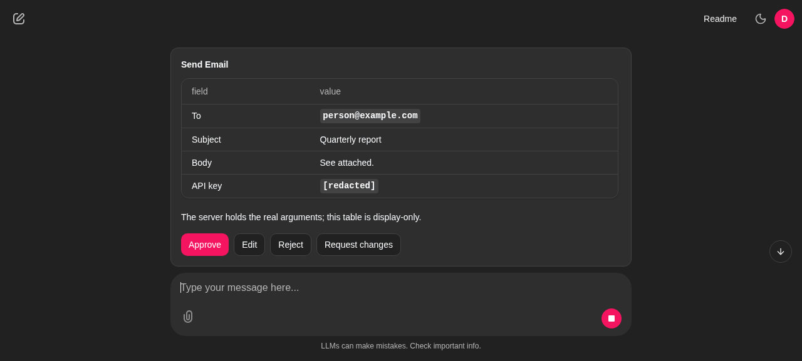
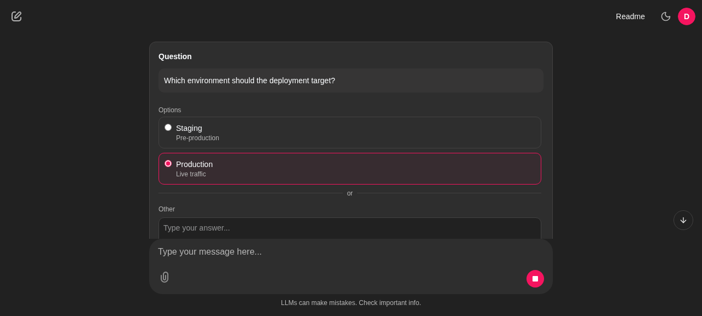

<h1 align="center">Chainlit NG</h1>

<p align="center">
  <b>Build production-ready conversational AI applications in Python.</b><br />
  Tool-call approvals, agent questions, observability, and a modern React 19 frontend — in minutes, not weeks.
</p>

<p align="center">
  <a href="https://pypi.org/project/chainlit-ng/"></a>
  <a href="https://www.npmjs.com/package/@chainlit-ng/react-client"></a>
  <a href="LICENSE"></a>
</p>

> **Fork notice**
>
> Chainlit NG is an independent fork of the original [Chainlit](https://github.com/Chainlit/chainlit) project. The upstream project is no longer actively maintained. This line continues development with security fixes, a React 19 frontend, and the interaction features below.
>
> The Python import is still `import chainlit as cl`. Only the distribution and CLI names changed.

## Install

```sh
pip install chainlit-ng
```

Requires Python 3.10 or newer. The CLI is now `chainlit-ng`; the `chainlit` command remains as an alias, so existing scripts keep working.

```sh
chainlit-ng hello
```

If the hello app opens in your browser, you are all set.

## Quickstart

Create `demo.py`:

```python
import chainlit as cl


@cl.step(type="tool")
async def tool():
    # Fake tool
    await cl.sleep(2)
    return "Response from the tool!"


@cl.on_message  # called every time a user sends a message
async def main(message: cl.Message):
    tool_res = await tool()
    await cl.Message(content=tool_res).send()
```

Run it with auto-reload:

```sh
chainlit-ng run demo.py -w
```

## What's new in 3.0

- **Tool-call approvals.** Pause a tool with `@cl.step(requires_approval=True)` or the explicit `cl.Approval` API. The server keeps the real arguments; the card shows a redacted preview. Users can approve, reject, edit generated form fields, or request changes with a comment. See [docs/approvals.md](docs/approvals.md).
- **Agent questions.** `cl.ask` pauses the step for an authored question with options, free text, or both. Answers carry explicit provenance and are marked as untrusted user input. See [docs/questions.md](docs/questions.md).
- **Thread sharing and grants.** Opt-in read-only sharing with named users, scoped by the data layer. See [docs/thread-sharing.md](docs/thread-sharing.md).
- **Safer MCP.** Servers are declared by name in server-side config, user-provided servers require an explicit URL allowlist, and per-user OAuth is supported for streamable HTTP. See [docs/mcp-oauth.md](docs/mcp-oauth.md).
- **OpenTelemetry traces.** Opt-in OTLP/HTTP export from the step tree, with a fixed redaction allowlist and bounded span attributes. See [docs/telemetry.md](docs/telemetry.md).
- **Skills and prompts.** App and per-user skills, a prompt gallery, and scheduled prompts with model selection. See [docs/skills.md](docs/skills.md) and [docs/scheduled-prompts.md](docs/scheduled-prompts.md).
- **UI improvements.** Optional message timestamps, compact chain-of-thought display, side-view opening by element id, and a configurable upload directory outside `APP_ROOT`.

## Screenshots

<table>
  <tr>
    <td width="50%">
      
      <p align="center"><sub>Review a tool call, edit its fields, or request changes.</sub></p>
    </td>
    <td width="50%">
      
      <p align="center"><sub><code>cl.ask</code> questions with options and free text.</sub></p>
    </td>
  </tr>
</table>

<p align="center">
  
  <br />
  <sub>Starting a new chat warns before discarding a pending approval or question.</sub>
</p>

## Security fixes

Security fixes in this line include:

- MCP CVE-2026-45018 (client-supplied stdio command execution) and CVE-2026-45019 (SSRF via user-provided MCP URLs and headers). See the [MCP advisory](docs/security-advisory-2026-mcp.md).
- Azure AD hybrid OAuth state and `id_token` verification with a per-login nonce.
- A structured 422 response for lone UTF-16 surrogates instead of a 500.
- Element ownership checks and upload validation.
- Markdown and media rendering hardening.
- Thread-grant ACLs, including owner-identity stripping for grantees.
- OpenTelemetry redaction and export bounds.

This is not a claim that every upstream bug is fixed. See the [changelog](CHANGELOG.md) for the full list.

## Migrating

Upgrading from upstream Chainlit 2.x or a 2.12 fork build? The [3.0 migration guide](docs/migration-3.0.md) covers the Python and npm renames, the Recoil to Zustand change, and breaking configuration updates.

The short version:

```sh
pip uninstall chainlit
pip install chainlit-ng==3.0.0
```

```sh
npm uninstall @chainlit/react-client
npm install @chainlit-ng/react-client@3.0.0
```

## Contributing

Contributions are welcome, whether it is a bug report, a documentation fix, or a feature. Start with [CONTRIBUTING.md](CONTRIBUTING.md), then run the backend and frontend checks described there before opening a pull request.

## License

Chainlit NG is open source under the [Apache License 2.0](LICENSE).

## Fork attribution

Chainlit NG is an independent fork of [Chainlit](https://github.com/Chainlit/chainlit). The original project is no longer actively maintained upstream. This repository continues that work under the Apache-2.0 license; the original authors and contributors retain credit for the code and documentation they wrote.
